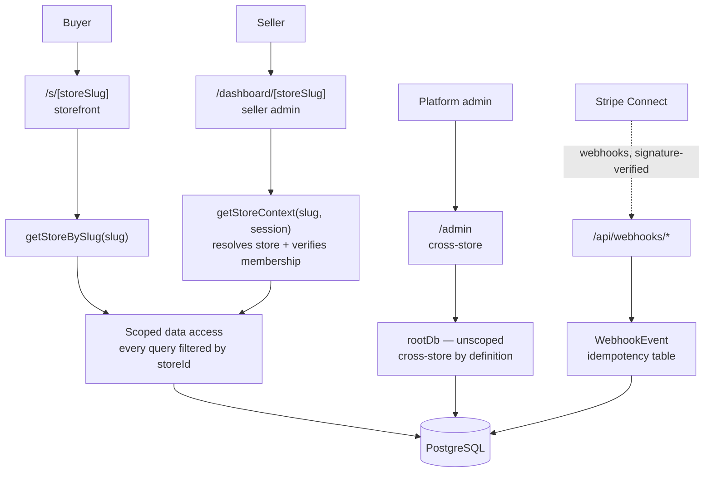

# Kiosk — a multi-tenant e-commerce platform

Anyone can sign up, open a store, list products and take real payments. Each
store is an isolated tenant with its own catalogue, its own orders and its own
Stripe account; the platform takes a commission at the moment of the charge.

> **Status: in active development.** Schema, tenancy, auth, store creation, slug
> routing and seed data are in. Stripe Connect, checkout, the discount engine and
> the admin surfaces are next — see [Roadmap](#roadmap).

---

## What works today

| | |
|---|---|
| Platform landing | Lists live stores at `/` |
| Storefronts | `/s/nordhavn-supply`, `/s/rosewater-ceramics` — branded per store, 15 products each |
| Auth | Email/password via Supabase Auth, with both email-confirmation callback shapes wired |
| Store creation | `/dashboard/new` — slug validation with live availability checking |
| Seller admin | `/dashboard/[storeSlug]` — membership-gated setup checklist |
| Seed | Two stores, 30 products, 56 variants, 6 collections, 6 discounts — idempotent |

---

## Stack

| Layer | Choice | Why |
|---|---|---|
| Framework | Next.js 16 (App Router) + TypeScript | Server Components keep tenant-scoped queries on the server by construction |
| Styling | Tailwind CSS v4 | |
| Database | PostgreSQL (Supabase) | |
| ORM | Prisma 7 | Client Extensions let the scoped data-access layer be enforced in one place rather than remembered at every call site |
| Auth | Supabase Auth | Same vendor as the database, and it keeps Postgres RLS reachable as a defence-in-depth stretch goal |
| Payments | Stripe Connect (Standard) | See below |
| Email | Resend | |
| Hosting | Vercel | |

### Why Connect **Standard**

Three account types were on the table:

- **Standard** — sellers onboard through a Stripe OAuth link. Stripe owns KYC,
  disputes and the seller's dashboard. Least code, least liability.
- **Express** — more control over onboarding UX via Account Links, at the cost
  of building and maintaining that UX, plus more platform-side liability.
- **Custom** — the platform owns the entire seller experience including
  compliance. Weeks of work and a regulatory surface this project has no
  business taking on.

Standard was chosen. At this scope the differentiator is *where the risk sits*,
not the UI: Standard puts identity verification and payout disputes with Stripe,
which is where a project this size wants them.

---

## Architecture



The important edge is `getStoreContext`. Seller-admin requests resolve their
tenant from the **URL slug plus the authenticated session**, never from a field
in the request body. Everything downstream receives an already-verified
`store.id`.

---

## Tenancy model

Three layers, because any one of them alone is a single point of failure.

**1. Schema.** Every root entity carries `storeId`, and every uniqueness
constraint a tenant can influence is composite with it:

```
@@unique([storeId, slug])   // products, collections
@@unique([storeId, code])   // discounts
@@unique([storeId, orderNumber])
@@unique([storeId, sku])    // variants
```

Two stores can both sell `/p/black-tee` and both define `WELCOME10`. The seed
does exactly that, so the constraint is exercised from day one.

`Variant` also carries a denormalised `storeId`. A variant id is the one
catalogue identifier a client hands us raw — add-to-cart, checkout lines — so it
is the prime IDOR surface. Carrying the tenant key locally turns "does this
variant belong to this store?" into one indexed predicate instead of a two-hop
join through `Product`.

**2. A scoped data-access layer.** Route handlers do not call the ORM directly.
`src/lib/db/root.ts` exports the unscoped client with a comment naming its only
three legitimate callers; everything store-scoped goes through
`src/lib/stores/context.ts`.

**3. Isolation tests.** Not yet written. The contract they will pin down: seller
A cannot read B's orders, edit B's products, apply B's discount code, or see B's
revenue.

> Postgres Row-Level Security via Supabase is a planned stretch — defence in
> depth, not a substitute for application-layer scoping.

---

## Design decisions worth defending

1. **Money is integer cents, everywhere.** `parseMoneyToCents` reads digits out
   of the string rather than going via `parseFloat(x) * 100` — 1.005 is not
   exactly representable in binary floating point and that route silently
   rounds it *down*. Tested.
2. **`OrderLine` snapshots title and price.** An order is a historical record,
   not a join. Deleting a product must not rewrite what someone was charged.
3. **`platformFeeCents` and `sellerNetCents` are stored on the order**, never
   recomputed. Commission rates change; settled orders must not.
4. **Commission is charged on the post-discount total.** The platform takes a
   cut of what the buyer actually paid. A seller running a 20% promotion is not
   billed commission on the 20% they gave away.
5. **`WebhookEvent` exists solely for idempotency.** Stripe retries; a replayed
   event must not decrement inventory twice.
6. **The cart is store-scoped.** One cart per store, no cross-store checkout —
   see [Out of scope](#out-of-scope).
7. **Non-members get 404, not 403,** on `/dashboard/[storeSlug]`. A seller
   poking at a rival's slug should learn nothing, including whether the guess
   was right.
8. **Rendering mode never depends on environment variables.**
   `getCurrentUser()` calls `connection()` before checking whether Supabase is
   configured. Without it, a build with no keys prerenders `/dashboard` as a
   static redirect and then silently switches to dynamic once keys are added.

---

## Out of scope

Named deliberately, not forgotten:

custom domains per store · cross-store unified cart · product reviews ·
subscriptions · refunds · tax calculation · multi-currency · shipping-rate APIs ·
seller analytics beyond basics · i18n

**On cross-store carts specifically:** splitting one payment across multiple
connected accounts is a genuinely hard settlement problem — separate charges,
separate refund paths, partial-failure handling. It is not a UI convenience and
it is not in this project.

**On custom domains:** wildcard DNS plus per-tenant SSL provisioning is
infrastructure work well outside this project's scope. Path-based routing ships.

---

## Local setup

Requires Node 22+.

```bash
npm install
```

**1. Database.** Either a local Postgres or a Supabase project.

```bash
npx prisma dev --name ecom
```

That prints `DATABASE_URL` and `SHADOW_DATABASE_URL`. Copy `.env.example` to
`.env` and paste them in.

**2. Supabase** (needed for auth; storefronts work without it). Create a project
at [supabase.com](https://supabase.com), then from Project Settings → API copy
the URL, the anon key and the service-role key into `.env`.

Set the redirect URLs under Authentication → URL Configuration:

```
http://localhost:3000/auth/confirm
http://localhost:3000/auth/callback
```

**3. Migrate and seed.**

```bash
npm run db:migrate
npm run db:seed
```

With `SUPABASE_SERVICE_ROLE_KEY` set, the seed also provisions the demo accounts
in Supabase Auth so you can log in as them:

| Account | Role |
|---|---|
| `nordhavn@example.com` | owns `/s/nordhavn-supply` |
| `rosewater@example.com` | owns `/s/rosewater-ceramics` |
| `admin@example.com` | platform admin |

Password: `kiosk-demo-2026`. Demo fixtures — never reuse these anywhere real.

**4. Run.**

```bash
npm run dev
```

### Scripts

| | |
|---|---|
| `npm run dev` | Dev server |
| `npm run build` | Generate Prisma client, then production build |
| `npm test` | Vitest |
| `npm run typecheck` | `tsc --noEmit` (run `npm run build` first — Next generates route types) |
| `npm run db:migrate` | Create and apply a migration |
| `npm run db:seed` | Seed the demo stores (idempotent) |
| `npm run seed:images` | Refresh seed photography from Openverse |

---

## Roadmap

| Milestone | Ships | |
|---|---|---|
| Foundation | Scaffold, multi-tenant schema, auth, store creation, slug routing, seed | ✅ |
| Data layer | Scoped data-access layer + isolation tests, product CRUD with images and variants | |
| Storefront | Listing, search, filters, detail, cart | |
| Connect | Stripe Connect onboarding, `account.updated` webhook, activation gating | |
| Checkout | Direct charges with application fee, `payment_intent.succeeded`, inventory, emails | |
| Discounts | Discount engine + tests, discount admin, checkout integration | |
| Surfaces | Seller dashboard, platform admin, buyer order history, mobile pass | |

---

## Credits

Demo photography is openly licensed and pulled from
[Openverse](https://openverse.org). See [CREDITS.md](CREDITS.md).
