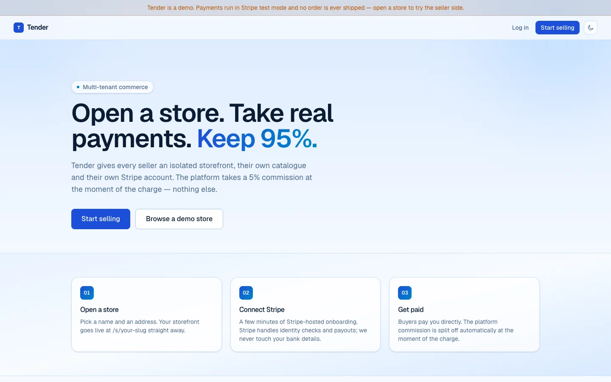
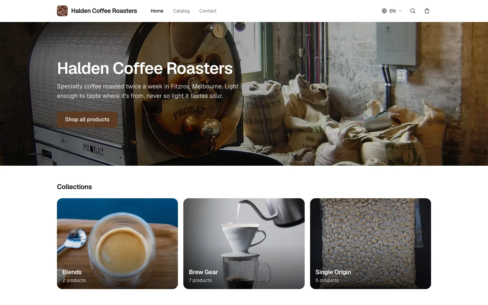
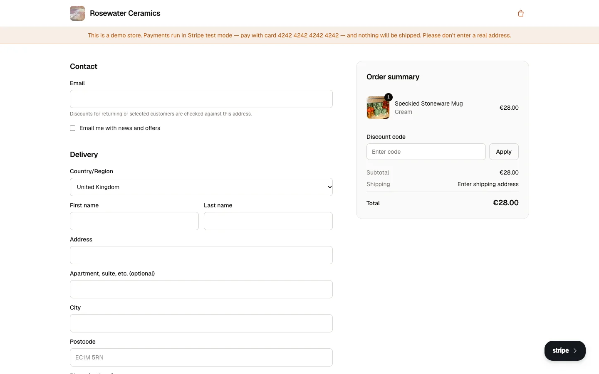
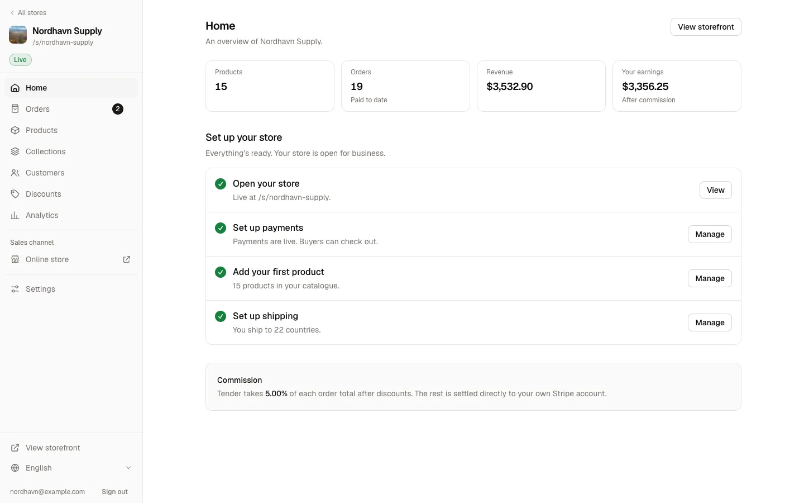

# Tender

**A multi-tenant e-commerce platform.** Anyone can sign up, open a store, list
products and take payments. Each store is an isolated tenant with its own
catalogue, orders and Stripe account, and the platform takes a commission (5%
by default) at the moment of the charge.

**Live demo:** coming soon
<!-- TODO: replace with https://<project>.vercel.app once deployed -->

> The demo runs Stripe in **test mode** and nothing is ever shipped. Sign up to
> open your own store and try the seller side, or check out in a demo store with
> card `4242 4242 4242 4242`, any future expiry and any CVC.

| Landing page | Storefront |
|---|---|
|  |  |
| **Checkout** | **Seller admin** |
|  |  |

---

## Features

**For shoppers**
- Branded storefronts at `/s/<store>`: catalogue, collections, search and
  product pages, priced in the store's own currency
- A one-page checkout with an embedded Stripe Payment Element (3-D Secure
  included), address forms that adapt to 30+ countries, and an optional saved
  checkout
- Discount codes and automatic discounts priced live; "Buy it now" without
  losing the cart
- Cash on delivery where the seller offers it

**For sellers**
- A seller admin for orders, products with variants and photos, collections,
  customers and analytics, with live alerts for new paid orders
- Discounts: percentage, fixed amount, buy X get Y and free shipping, with
  segments, limits and schedules
- Shipping zones and rates by country, region, order value or weight
- A theme editor with sections, fonts, accent colours, a live preview and
  draft/publish
- Stripe-hosted onboarding: refunds and disputes are handled in the seller's
  own Stripe Dashboard and synced back

**Platform and accounts**
- Store moderation: feature stores on the landing page, or suspend them
- Account settings: email change, password change, active sessions, data
  export and account deletion
- Storefront and admin in 12 languages, including right-to-left Arabic

The full list, surface by surface, is in [docs/features.md](docs/features.md).

---

## Tech stack

| Layer | Choice |
|---|---|
| Framework | [Next.js 16](https://nextjs.org) (App Router), React 19, TypeScript |
| Styling | Tailwind CSS v4 |
| Database | PostgreSQL on [Supabase](https://supabase.com), [Prisma 7](https://www.prisma.io) |
| Auth, storage, realtime | Supabase Auth, Storage and Realtime |
| Payments | [Stripe Connect](https://docs.stripe.com/connect): Accounts v2, direct charges, Payment Element |
| Validation & tests | Zod, Vitest |
| Hosting | Vercel (with a daily Vercel Cron cleanup) |

---

## How it works

- **The tenant comes from the URL and the session, never the request body.**
  Seller-admin requests resolve their store through `getStoreContext(slug,
  session)`, which also proves membership; non-members get a 404, not a 403.
- **Every query is scoped by `storeId`.** Uniqueness constraints are composite
  with it, and only a few named callers may use the unscoped client.
- **Direct charges on the seller's Stripe account,** with the platform's
  commission taken as an `application_fee_amount` on the post-discount total.
- **Webhooks and settlement are idempotent.** An order is settled by a
  conditional `UPDATE … WHERE status = 'PENDING'`, so a retried webhook and the
  confirmation page can race without double-counting stock.
- **Money is integer cents** everywhere, and orders snapshot their lines,
  prices, addresses and commission.
- **The Supabase Data API is closed.** Grants are revoked and RLS is a deny-all
  backstop; every read and write goes through Prisma on the server.

The reasoning behind each, with a diagram, is in
[docs/architecture.md](docs/architecture.md).

---

## Getting started

**Prerequisites:** Node.js 22+, a Supabase project, and a Stripe account in
test mode with Connect enabled (only needed for card payments). The
[Stripe CLI](https://docs.stripe.com/stripe-cli) forwards webhooks locally.

```bash
git clone https://github.com/keraa00/Tender-ecommerce.git
cd Tender-ecommerce
npm install
cp .env.example .env           # fill in the values, see below

npx prisma dev --name ecom     # in its own terminal: a local Postgres; paste
                               # the DATABASE_URL and SHADOW_DATABASE_URL it prints
npm run db:migrate             # apply migrations
npm run storage:setup          # create the product-images bucket in Supabase
npm run db:seed                # demo stores, products and a year of orders
npm run dev                    # http://localhost:3000
```

For card payments, also run `stripe login` and `npm run stripe:listen` while
you test.

Supabase needs a few dashboard settings (redirect URLs and token-hash email
templates), and Stripe needs Connect branding before onboarding works. Both
are covered step by step in **[docs/setup.md](docs/setup.md)**, along with the
demo accounts the seed creates.

### Environment variables

Copy `.env.example`, which documents each variable in detail.

| Variable | Purpose |
|---|---|
| `DATABASE_URL` | Postgres connection, used by the app and the migration CLI |
| `SHADOW_DATABASE_URL` | Scratch database for `prisma migrate dev` (local only) |
| `NEXT_PUBLIC_SUPABASE_URL` | Supabase project URL |
| `NEXT_PUBLIC_SUPABASE_ANON_KEY` | Supabase publishable key |
| `SUPABASE_SERVICE_ROLE_KEY` | Supabase secret key — **server-only**; uploads, seeding, account deletion |
| `NEXT_PUBLIC_APP_URL` | Public URL of the app |
| `NEXT_PUBLIC_ADMIN_HOST` | Host of the seller admin; set it to the app's own host to keep the admin on `/dashboard/<slug>` |
| `NEXT_PUBLIC_AUTH_COOKIE_DOMAIN` | Optional override for the auth cookie's domain |
| `STRIPE_SECRET_KEY` | Stripe secret key — **server-only** |
| `NEXT_PUBLIC_STRIPE_PUBLISHABLE_KEY` | Stripe publishable key |
| `STRIPE_CONNECT_WEBHOOK_SECRET` | Signing secret for connected-account webhooks — **server-only** |
| `CRON_SECRET` | Bearer token Vercel Cron sends to `/api/cron/sweep` — **server-only** |
| `SEED_PASSWORD` | Password for the seeded demo accounts — **local only**, never deployed |

### Scripts

| Command | Does |
|---|---|
| `npm run dev` | Start the dev server |
| `npm run build` | Generate the Prisma client, then build for production |
| `npm start` | Serve the production build |
| `npm test` / `npm run test:watch` | Run the Vitest suite once / in watch mode |
| `npm run typecheck` | `tsc --noEmit` (run `npm run build` first; Next.js generates route types) |
| `npm run lint` | ESLint |
| `npm run db:generate` | Regenerate the Prisma client after a schema change |
| `npm run db:migrate` | Create and apply a migration against a local database |
| `npm run db:deploy` | Apply existing migrations to a hosted database |
| `npm run db:seed` | Seed the demo stores and their orders (idempotent) |
| `npm run db:studio` | Open Prisma Studio |
| `npm run storage:setup` | Create the public `product-images` bucket (idempotent) |
| `npm run seed:images` | Refresh the seed photography from Openverse and Wikimedia Commons |
| `npm run seed:passwords` | Move every seeded demo account onto `SEED_PASSWORD` |
| `npm run stripe:listen` | Forward connected-account webhooks to the dev server (needs the Stripe CLI) |

---

## Project structure

```
src/
  app/
    (marketing)/       landing page, store directory, terms, privacy
    (auth)/  auth/     sign-up, login, password reset, email-link callbacks
    dashboard/         account settings, store creation, platform admin,
                       and the seller admin at dashboard/[storeSlug]
    s/[storeSlug]/     storefronts, cart and checkout
    api/               Stripe webhooks, daily cron sweep
  lib/                 domain logic: stores, products, checkout, discounts,
                       payments, shipping, orders, theme, i18n, db access
  components/          UI for the storefront, seller admin, account settings
                       and theme editor
  proxy.ts             host routing for the admin subdomain
prisma/                schema, migrations and seed data
scripts/               storage setup and seed helpers
tests/                 Vitest unit tests
docs/                  setup, deployment, architecture, features
```

---

## Testing

```bash
npm test             # unit tests (Vitest)
npm run build        # also generates the route types typecheck needs
npm run typecheck
npm run lint
```

The tests cover the pure logic: the discount engine, checkout pricing and
shipping rates, money parsing, admin host routing, refunds, the cleanup sweep,
form parsing and translations.

---

## Deployment

Tender deploys to Vercel as it is. The demo runs on a single `*.vercel.app`
host, with Stripe in test mode and the seller admin at `/dashboard/<slug>`.
With a custom domain the admin moves to `admin.<your-domain>`. Migrations are
applied with `npm run db:deploy`, never by the build.

Step-by-step instructions are in **[docs/deployment.md](docs/deployment.md)**,
covering environment variables, Supabase SMTP and auth URLs, the Stripe
webhook endpoint, the platform admin role and a smoke test.

---

## Project status

Tender is a working demo and a portfolio project, not a production service.
Not built yet:

- Order confirmation emails (auth emails work)
- Automated tenant-isolation tests
- Order history for shoppers
- Application-level rate limiting or CAPTCHA
- Live-mode payments

Some things are deliberately out of scope, such as cross-store carts, tax
calculation and custom domains per store. See
[docs/architecture.md](docs/architecture.md#out-of-scope) for why.

---

## Security

A white-box security review of the codebase is published in
[SECURITY_AUDIT.md](SECURITY_AUDIT.md). It includes the findings still open and
accepted for the demo.

If you find a vulnerability, please **don't open a public issue**. Report it
privately through GitHub's
[Report a vulnerability](https://github.com/keraa00/Tender-ecommerce/security/advisories/new)
form on the Security tab.

---

## Credits

Demo product photography is openly licensed and comes from
[Openverse](https://openverse.org) and
[Wikimedia Commons](https://commons.wikimedia.org). Attributions are in
[CREDITS.md](CREDITS.md).

## License

Copyright © 2026 Kerim Smajlovic. All rights reserved.

The source code is public for viewing and evaluation only. No licence is
granted to use, copy, modify or distribute it. If you'd like to use any part
of it, please get in touch.
