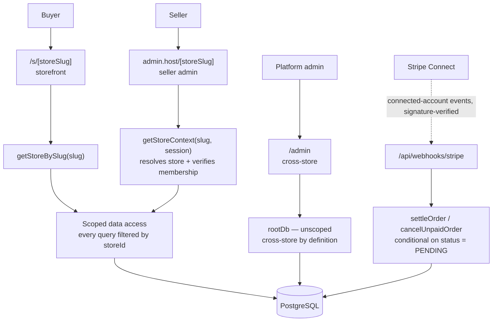

# Tender — a multi-tenant e-commerce platform

Anyone can sign up, open a store, list products and take real payments. Each
store is an isolated tenant with its own catalogue, its own orders and its own
Stripe account; the platform takes a commission at the moment of the charge.

> **Status: in active development.** Schema, tenancy, auth, store creation, slug
> routing, product management, discounts (admin, engine, cart and checkout),
> shipping zones and rates, a Shopify-style checkout, Stripe Connect onboarding,
> card payments with the platform's commission, and seed data are in. Order
> emails and the remaining admin surfaces are next — see [Roadmap](#roadmap).

---

## What works today

| | |
|---|---|
| Platform landing | Lists live stores at `/` |
| Storefronts | `/s/nordhavn-supply` (USD), `/s/rosewater-ceramics` (EUR) — branded per store, priced in each store's own currency |
| Auth | Email/password via Supabase Auth, with both email-confirmation callback shapes wired |
| Store creation | `/dashboard/new` — slug validation with live availability checking |
| Seller admin | `admin.<host>/[storeSlug]` — its own subdomain, with a left drawer: Home, Orders, Products, Customers, Discounts, Analytics |
| Product management | `admin.<host>/[storeSlug]/products` — create, edit and delete products with variants and uploaded photos; draft / published / archived; a weight per option (kg in, integer grams stored) and a "requires shipping" flag for digital products and services |
| Store settings | `admin.<host>/[storeSlug]/settings` — **General**: logo, the store's currency (two-decimal currencies only; locked once the store has an order) and a customer contact email. **Payments**: pick the business's country and connect a Stripe account (Accounts v2) through Stripe-hosted onboarding, continue an unfinished setup, and see whether charges and payouts are enabled — read live from Stripe on every visit. **Shipping and delivery**: zones of countries, optionally narrowed to states or provinces, one zone per country, an optional rest-of-world zone, and rates per zone — price, delivery estimate, and an optional order-price or weight range — with "You ship to N countries". **Checkout**: phone, company, first name, address line 2, marketing opt-in and order note |
| Discounts | `admin.<host>/[storeSlug]/discounts` — codes and automatic discounts: percentage, fixed amount, buy X get Y, free shipping; whole order, products or collections; minimum spend or quantity; all customers, segments or named customers; total and per-customer limits; schedule; on/off; stacking. The pricing engine is pure and tested, ready for checkout |
| Cart & checkout | Automatic discounts and codes priced live in the cart drawer, cart page and checkout. Checkout is one page, Shopify-style, under its own pared-down header: contact (with the optional marketing opt-in), delivery — a country select of only the countries the store ships to, named in the buyer's language, then address fields that follow the country (labels, region lists, postal-code formats for 30+ countries) — shipping method, billing address, payment and the order summary, which folds into a bar on phones. Every change is saved on the cart and re-priced on the server, so a refresh loses nothing and the server's total is the only one. Payment is Stripe's **Payment Element**, embedded in the page and themed to the store. "Pay now" places the order — line, discount, address and rate snapshots, commission on the discounted total, usage limits enforced and the rate re-checked in the order transaction — creates its PaymentIntent on the seller's Stripe account, and confirms it in place (3-D Secure included). The order turns **Paid** — stock taken, cart emptied — when the payment succeeds; a declined card leaves the cart and the order for another try. An order discounts bring to zero is placed paid without Stripe |
| Shipping | The chosen rate is charged; a free-shipping discount takes exactly that rate off. Rates are judged on the subtotal after item discounts and on the weight of what ships. A cart of digital products skips delivery entirely. A store that ships nowhere can still sell those, and says so for anything else |
| Buy it now | On every product page: checks out that one option and quantity from a cart of its own, so the buyer's cart is still there afterwards |
| Orders | `admin.<host>/[storeSlug]/orders` — list, and a page per order with its lines, totals, commission, discounts, customer, shipping address and method, billing address, note and a link to the payment in the seller's Stripe Dashboard. The buyer's confirmation page reads the payment from Stripe — paid, processing, or failed with a way back to try again — and shows the same delivery details |
| Seed | Two stores, 31 products (one of them a service), 58 variants with weights, 6 collections, 9 discounts, 7 shipping zones with domestic and international rates — idempotent |

---

## Stack

| Layer | Choice | Why |
|---|---|---|
| Framework | Next.js 16 (App Router) + TypeScript | Server Components keep tenant-scoped queries on the server by construction |
| Styling | Tailwind CSS v4 | |
| Database | PostgreSQL (Supabase) | |
| ORM | Prisma 7 | Client Extensions let the scoped data-access layer be enforced in one place rather than remembered at every call site |
| Auth | Supabase Auth | Same vendor as the database, and it keeps Postgres RLS reachable as a defence-in-depth stretch goal |
| Payments | Stripe Connect (Standard-equivalent accounts), Payment Element | See below |
| Email | Resend | |
| Hosting | Vercel | |

### Why Standard-equivalent accounts

Account type is the payments decision that is expensive to reverse. It fixes who
owns identity verification, who absorbs a chargeback, and how much onboarding UI
becomes the platform's problem.

| | Standard | Express | Custom |
|---|---|---|---|
| KYC | Stripe | Stripe, in a flow you trigger | The platform |
| Onboarding | Stripe-hosted (Account Links) | Stripe-hosted, lightly branded | Built from scratch |
| Seller dashboard | Full Stripe Dashboard | Cut-down Express dashboard | Built from scratch |
| Disputes | Seller | Seller, via the platform | Platform |
| Negative balances | Stripe | Platform | Platform |
| Per-account monthly fee | None | Yes | Yes |

**Standard was chosen.** At this scope the differentiator is *where the risk
sits*, not the onboarding UI. Identity verification, payouts and disputes
belong with Stripe and the seller, and the seller gets the full Stripe
Dashboard to handle them — a cheap trade when [refunds are out of
scope](#out-of-scope) here anyway.

Accounts are created with Stripe's **Accounts v2 API** (`/v2/core/accounts`):
`dashboard: "full"`, `defaults.responsibilities` of
`fees_collector: "stripe"` and `losses_collector: "stripe"` — which makes
Stripe responsible for KYC — and the `merchant` configuration with card
payments requested. Stripe reports that combination as a Standard account.
Owners onboard through v2 **Account Links**, Stripe-hosted onboarding.

Why not the older routes: Stripe refuses Accounts v1 creation for new Connect
platforms unless a compatibility setting is switched on, and its docs say OAuth
"isn't recommended for new Connect platforms". The costs of v2:

- **The owner picks their country before going to Stripe.** Accounts v2 needs
  it to add the merchant configuration, and it can't change afterwards.
  Settings → Payments offers the countries where Stripe takes merchants
  (`STRIPE_MERCHANT_COUNTRIES` in `src/lib/payments/rules.ts`, from
  stripe.com/global — Stripe's Country Specs API also lists countries it only
  pays out to).
- **A seller who already has a Stripe account** signs in with it but gets a new
  account for Tender, rather than connecting the old one.
- **Readiness is read from capabilities, not flags.** "Can take money" is
  `configuration.merchant.capabilities.card_payments.status === "active"`;
  "has submitted their details" is "card payments requested and no requirement
  awaiting the seller" (`accountReadiness`). Accounts created earlier through
  v1 read the same way — Accounts v2 manages them too.

**Express** would be right if onboarding conversion were the business, and
**Custom** means owning KYC and a regulatory surface this project has no
business taking on.

What that choice commits the code to:

- **Direct charges.** Each order's PaymentIntent is created *on* the connected
  account — `{ stripeContext: store.stripeAccountId }` — with commission taken
  as `application_fee_amount`. Stripe's processing fee comes out of the
  seller's side, not the platform's. Stripe.js loads as the same account, so the
  Payment Element can confirm it.
- **The buyer's card statement shows the seller,** not the platform. Correct
  for a marketplace, and worth knowing before the first "what is this charge"
  email.
- **One webhook endpoint, for connected accounts.** With direct charges, every
  event Tender acts on — `account.updated`, `capability.updated`,
  `account.application.deauthorized`, `payment_intent.succeeded`,
  `payment_intent.canceled` — happens on a seller's account. (Accounts v2
  accounts still send these v1 events, in the connected-accounts scope;
  `capability.updated` is the one that says card payments switched on.) They arrive at `/api/webhooks/stripe` with an `account` field naming
  the seller. Connect also delivers the seller's own payments taken elsewhere;
  PaymentIntents without Tender's order id in their metadata are ignored.
- **This database is the source of truth for orders.** Charges live on the
  connected account and aren't queryable from the platform account by default.
- **A store cannot sell until Stripe says so.** `stripeChargesEnabled` is
  copied from the account — on `account.updated` and `capability.updated`,
  and whenever the owner opens Settings → Payments — and checkout is gated on
  it. The handler re-reads the account rather than trusting the payload, and
  the v2 read can trail the v1 event by a few seconds: when a recent event says
  card payments just went live but the read disagrees, the handler re-reads
  for a few seconds, then answers 500 so Stripe redelivers instead of leaving
  the store closed (`eventSignalsCardActive`). A row with a
  `stripeAccountId` is not the same thing as a store that can take money.
  Finishing onboarding is also what moves a new store from PENDING to ACTIVE.
- **Stock is taken when the money is in, not when the order is placed.** An
  order is placed unpaid with its discounts redeemed, then paid by its
  PaymentIntent; the transaction that flips it to PAID takes the stock and
  empties the cart. An abandoned payment holds no stock, and placing the order
  again cancels the old attempt — PaymentIntent first — and gives its discount
  uses back.

---

## Architecture



The important edge is `getStoreContext`. Seller-admin requests resolve their
tenant from the **URL slug plus the authenticated session**, never from a field
in the request body. Everything downstream receives an already-verified
`store.id`.

### The admin subdomain

The seller admin is served from `admin.<host>`; the platform — landing page,
login, storefronts, the store list — stays on the root host. `src/proxy.ts`
rewrites `admin.tender.com/acme/orders` onto the internal route
`/dashboard/acme/orders`, and redirects each host's traffic to whichever one
owns it, so every page has exactly one canonical URL.

Internally the route tree kept its old shape. That is the point: route files,
`getStoreContext()` and `revalidatePath()` all still speak `/dashboard/…`, so
moving the admin onto a subdomain did not become a rename of every route in the
app. The rules live in `src/lib/admin/routing.ts` as pure functions with tests —
a proxy is exactly where an untested branch becomes a redirect loop.

Three consequences worth knowing:

- **The host proves nothing.** A request arriving on `admin.` is no more trusted
  than one arriving anywhere else. Membership is still proved by
  `getStoreContext()`, which 404s — not 403s — for non-members.
- **`redirect()` and `revalidatePath()` diverge.** They take strings that look
  identical and are not: `revalidatePath` names an internal route and keeps the
  `/dashboard` prefix, while `redirect` names a URL a browser will visit and
  goes through `src/lib/admin/links.ts`.
- **One session spans both hosts.** The Supabase auth cookie is written with
  `Domain=<root hostname>` rather than host-only. Without that, a cookie set at
  login on the root host is never sent to the admin subdomain.

Setting `NEXT_PUBLIC_ADMIN_HOST` to the same host as `NEXT_PUBLIC_APP_URL`
switches the whole split off, and `/dashboard/<slug>` paths work exactly as they
did before — useful anywhere wildcard DNS is not available.

---

## Tenancy model

Four layers, because any one of them alone is a single point of failure.

**1. Schema.** Every root entity carries `storeId`, and every uniqueness
constraint a tenant can influence is composite with it:

```
@@unique([storeId, slug])   // products, collections
@@unique([storeId, code])   // discounts
@@unique([storeId, orderNumber])
@@unique([storeId, sku])    // variants
```

Two stores can both sell `/p/black-tee` and both define `WELCOME10`. The seed
does exactly that, so the constraint is exercised from day one.

`Variant` also carries a denormalised `storeId`. A variant id is the one
catalogue identifier a client hands us raw — add-to-cart, checkout lines — so it
is the prime IDOR surface. Carrying the tenant key locally turns "does this
variant belong to this store?" into one indexed predicate instead of a two-hop
join through `Product`.

**2. A scoped data-access layer.** Route handlers do not call the ORM directly.
`src/lib/db/root.ts` exports the unscoped client with a comment naming its only
three legitimate callers; everything store-scoped goes through
`src/lib/stores/context.ts`.

**3. Isolation tests.** Not yet written. The contract they will pin down: seller
A cannot read B's orders, edit B's products, apply B's discount code, or see B's
revenue.

**4. The Supabase Data API is closed.** Supabase publishes every table in
`public` through PostgREST, and its stock grants give `anon` and `authenticated`
full DML on each one. `anon` is the role behind `NEXT_PUBLIC_SUPABASE_ANON_KEY`,
which ships to every browser that loads the app — so the default posture leaves
orders, carts and users readable and writable by anyone who reads the page
source, on a route that never runs the application code enforcing `storeId`.

The migration `20260827080543_revoke_data_api_access` closes it outright rather
than modelling it with policies: the table, sequence and function grants are
revoked from both roles, so are the default privileges that would re-grant them
on the next `CREATE TABLE`, and RLS is enabled with no policies on all fifteen
tables as a deny-all backstop. Nothing here needs the Data API — `supabase-js`
is called only for `auth.*` and Storage, and every database read and write goes
through Prisma on the direct connection. `service_role` is left intact: it is
server-only, and the seed and product image uploads depend on it.

> RLS here is a backstop, not the tenancy mechanism. Prisma connects as the
> table owner, which bypasses it. Per-tenant RLS policies — scoping enforced in
> the database rather than above it — remain a stretch goal.

**Product images** are the one thing that lives outside Postgres. They go to the
`product-images` Storage bucket under a `<storeId>/` prefix, written server-side
with `service_role` after `getStoreContext()` has already tied the store to the
session — so the tenant prefix is never taken from anything a client sent. No
storage policies are created, which leaves `anon` able to read (storefront photos
are public by definition, and `next/image` cannot optimise what it cannot fetch)
and unable to upload, list or delete. Verified against the live project.

> Supabase's `remove()` reports no error when a policy filters the object out, so
> a delete that did nothing looks like a delete that worked. The object surviving
> is the thing to assert, not the absent error.

---

## Design decisions worth defending

1. **Money is integer cents, everywhere.** `parseMoneyToCents` reads digits out
   of the string rather than going via `parseFloat(x) * 100` — 1.005 is not
   exactly representable in binary floating point and that route silently
   rounds it *down*. Tested.
2. **`OrderLine` snapshots title and price.** An order is a historical record,
   not a join. Deleting a product must not rewrite what someone was charged.
3. **`platformFeeCents` and `sellerNetCents` are stored on the order**, never
   recomputed. Commission rates change; settled orders must not.
4. **Commission is charged on the post-discount total.** The platform takes a
   cut of what the buyer actually paid. A seller running a 20% promotion is not
   billed commission on the 20% they gave away.
5. **Stock moves only in the transaction that flips an order to PAID.** Stripe
   retries webhooks, and the confirmation page settles the order too, so the
   same payment can arrive twice at once. Settling is a conditional
   `UPDATE … WHERE status = 'PENDING'`, and only the call whose update actually
   changed the row takes stock, empties the cart or — for a cancellation — gives
   discount uses back. A replay finds the order already moved and does nothing.
   `WebhookEvent` records which events were handled and short-circuits
   redeliveries; it is not what makes them safe.
6. **The cart is store-scoped.** One cart per store, no cross-store checkout —
   see [Out of scope](#out-of-scope).
7. **Non-members get 404, not 403,** on `/dashboard/[storeSlug]`. A seller
   poking at a rival's slug should learn nothing, including whether the guess
   was right.
8. **Rendering mode never depends on environment variables.**
   `getCurrentUser()` calls `connection()` before checking whether Supabase is
   configured. Without it, a build with no keys prerenders `/dashboard` as a
   static redirect and then silently switches to dynamic once keys are added.
9. **Discount rules are enforced twice, usage limits once — at the right
   moment.** The form parser (`src/lib/discounts/form.ts`) explains a bad
   discount in words; CHECK constraints in `20260926160000_discount_rules`
   refuse one from any other write path. The engine
   (`src/lib/discounts/engine.ts`) decides amounts from counts it read earlier,
   which is fine for showing a total; `redeemDiscounts` re-checks inside the
   order transaction with a conditional `UPDATE … WHERE usage_count <
   usage_limit`, so two buyers racing for the last use cannot both get it.
   Customer segments are rules over order history, not stored lists — there is
   no customers table to keep in step.
10. **Shipping is quoted in one pure function, and the client only ever
    requests.** `quoteCheckout` (`src/lib/checkout/quote.ts`) prices item
    discounts first, picks the zone and the rates the order qualifies for, then
    prices again with the chosen rate so a free-shipping discount takes
    exactly that off. A rate id from the browser is a request: one that is not
    among the eligible rates for this store, address and cart is never
    charged, and the order transaction re-reads the rate by id, store, zone and
    price. Addresses, the rate's name, zone and estimate, and the currency are
    snapshotted onto the order like its lines. Tax will be one more term in
    `summarisePricing` and one more column.
11. **"Buy it now" is a second cart, not a detour around the first.** A
    `BUY_NOW` cart beside the buyer's own, keyed the same way, so checkout,
    discount codes, re-pricing and the saved draft all work on it unchanged
    and paying for the order deletes only it. The cost is one more row per
    session; stashing and restoring the everyday cart instead would risk
    losing it on any failure in between.

---

## Out of scope

Named deliberately, not forgotten:

custom domains per store · cross-store unified cart · product reviews ·
subscriptions · refunds · tax calculation · multi-currency · shipping-rate APIs ·
seller analytics beyond basics · i18n

**On cross-store carts specifically:** splitting one payment across multiple
connected accounts is a genuinely hard settlement problem — separate charges,
separate refund paths, partial-failure handling. It is not a UI convenience and
it is not in this project.

**On custom domains:** wildcard DNS plus per-tenant SSL provisioning is
infrastructure work well outside this project's scope. Path-based routing ships.

---

## Local setup

Requires Node 22+.

```bash
npm install
```

**1. Database.** Either a local Postgres or a Supabase project.

```bash
npx prisma dev --name ecom
```

That prints `DATABASE_URL` and `SHADOW_DATABASE_URL`. Copy `.env.example` to
`.env` and paste them in.

**2. Supabase** (needed for auth; storefronts work without it). Create a project
at [supabase.com](https://supabase.com), then from Project Settings → API Keys
copy the project URL, the *publishable* key (`sb_publishable_…`) and a *secret*
key (`sb_secret_…`) into `.env`. Supabase renamed these: publishable was the
anon key, secret was the service-role key. The variable names in `.env.example`
keep the old spelling — only the values changed.

Set the redirect URLs under Authentication → URL Configuration:

```
http://localhost:3000/auth/confirm
http://localhost:3000/auth/callback
```

Then, under Authentication → Emails → Templates, change **Confirm signup** to
send the token hash:

```html
<h2>Confirm your signup</h2>
<p>
  <a href="{{ .RedirectTo }}&token_hash={{ .TokenHash }}&type=signup"
    >Confirm your email</a
  >
</p>
```

This is worth doing even though `/auth/confirm` also accepts the stock
`{{ .ConfirmationURL }}` template. That default sends the user through
Supabase's own verify endpoint, which hands back a PKCE code redeemable only in
the browser that signed up — so confirming from a phone, or from webmail in a
second browser, fails. A token hash carries no such tie and works anywhere.

Appending to `{{ .RedirectTo }}` rather than rebuilding the URL from
`{{ .SiteURL }}` is what preserves the `next` path the app put on
`emailRedirectTo`, so a user confirming from a deep link still lands where they
were headed.

If you point `DATABASE_URL` at Supabase rather than a local database, append
`?sslmode=verify-full&sslrootcert=./certs/supabase-ca.crt`. The pooler serves a
certificate signed by Supabase's own root CA, which the driver behind
`@prisma/adapter-pg` rejects when the system trust store is all it has. That
path is resolved against the process working directory, so every entry point —
dev server, seed, scripts — has to be launched from the repo root.
`.env.example` carries the long version, including why the session pooler is the
one to use.

**3. Product image storage.**

```bash
npm run storage:setup
```

Creates the public `product-images` bucket that seller uploads go to. Idempotent,
and safe to re-run after changing the limits in `scripts/setup-storage.ts`.

**4. Migrate and seed.**

```bash
npm run db:migrate
npm run db:seed
```

With `SUPABASE_SERVICE_ROLE_KEY` set, the seed also provisions the demo accounts
in Supabase Auth so you can log in as them:

| Account | Role |
|---|---|
| `nordhavn@example.com` | owns `/s/nordhavn-supply` |
| `rosewater@example.com` | owns `/s/rosewater-ceramics` |
| `admin@example.com` | platform admin |

Password: `tender-demo-2026`. Demo fixtures — never reuse these anywhere real.

Both stores also get about a year of orders (`prisma/seed-orders.ts`), so
Customers, Orders and Analytics have something to show. Their dates count back
from when the seed runs, so reseeding keeps recent customers recent.

The demo stores start without a Stripe account, so their storefronts browse but
checkout says payments aren't set up — step 5 connects one.

**5. Payments (Stripe test mode).**

1. In a Stripe sandbox or test mode, copy the keys from Developers → API keys
   into `STRIPE_SECRET_KEY` (`sk_test_…`) and
   `NEXT_PUBLIC_STRIPE_PUBLISHABLE_KEY` (`pk_test_…`).
2. Turn on Connect (Dashboard → Connect → Get started) and fill in the
   platform's branding under Connect settings — name, icon, colour. Stripe-hosted
   onboarding will not start without it.
3. Forward connected-account webhooks to the dev server with the
   [Stripe CLI](https://docs.stripe.com/stripe-cli), and keep it running while
   you test:

   ```bash
   stripe login
   npm run stripe:listen
   ```

   The script is `stripe listen --events-from @accounts --events …
   --forward-connect-to localhost:3000/api/webhooks/stripe`, with the five
   event types the app handles.

   Recent CLI versions refuse to listen without an explicit event list. CLI
   1.50+ also needs **Settings → Team and security → MCP and CLI access**
   switched on before `stripe login` works. Put the `whsec_…` it prints (or
   `stripe listen --print-secret`) in `STRIPE_CONNECT_WEBHOOK_SECRET`. Without it the
   app still works — Settings → Payments and the confirmation page read Stripe
   directly — but stores and orders only update when someone looks.
4. Sign in as a store owner, open Settings → Payments, choose the country the
   business is based in (United States makes the test values below simplest),
   click **Connect with Stripe** and finish test onboarding: SMS code
   `000000`, date of birth `01/01/1901`, address line 1 `address_full_match`,
   ID / SSN `000000000` (or `0000` for the last four), website
   `https://accessible.stripe.com`, and the test bank account Stripe offers.
   Back in the admin the store shows **Under review**, then **Live** within a
   minute or two.
5. Check out with `4242 4242 4242 4242`, any future expiry and any CVC.
   `4000 0025 0000 3155` asks for 3-D Secure; `4000 0000 0000 9995` is declined.

**6. Run.**

```bash
npm run dev
```

Locally that is one host:

| | |
|---|---|
| `http://localhost:3000` | Everything — landing page, login, storefronts, your store list |
| `http://localhost:3000/dashboard/<slug>` | The seller admin |

In production the seller admin moves to its own subdomain, `admin.<your-domain>`,
and `/dashboard/<slug>` redirects there. `.env` ships with
`NEXT_PUBLIC_ADMIN_HOST="localhost:3000"`, which switches that split off for
local development; clearing it turns it back on.

The reason local development does not run the split is the session rather than
the routing. One session has to cover both hosts, which takes an auth cookie
scoped to the parent domain, and `localhost` cannot carry one: it is a public
suffix, so RFC 6265 §5.3 has the browser *downgrade* `Domain=localhost` to a
host-only cookie rather than honour it. `admin.localhost` never receives the
session, and a signed-in seller bounces between the login page and an admin that
cannot see them.

A hostname with a dot does carry it, so the split can be run locally by clearing
`NEXT_PUBLIC_ADMIN_HOST` and pointing `NEXT_PUBLIC_APP_URL` at one:

- **`http://lvh.me:3000`** — `lvh.me` and `*.lvh.me` are public DNS names
  resolving to 127.0.0.1, so nothing needs adding to `/etc/hosts`.
- **A name of your own** — `127.0.0.1  tender.test admin.tender.test` in
  `/etc/hosts`. `.test` is reserved for this (RFC 6761) and, unlike `.local`,
  does not collide with mDNS.

Either way the browser marks plain `http://` on a real hostname Not Secure —
only `localhost` is treated as a trustworthy origin. For a padlock, issue a
certificate covering both hosts with [mkcert](https://github.com/FiloSottile/mkcert)
(`mkcert lvh.me "*.lvh.me"`) and pass it to `next dev --experimental-https-key`
and `--experimental-https-cert`.

### Deploying

Nothing about the split is production-only — the same variables describe it
anywhere:

| | |
|---|---|
| `NEXT_PUBLIC_APP_URL` | `https://your-domain.com` |
| `NEXT_PUBLIC_ADMIN_HOST` | empty, so the admin host is derived as `admin.your-domain.com` |
| DNS | an `admin.` record pointing at the same deployment |
| Supabase → Authentication → URL Configuration | `https://your-domain.com/auth/confirm` and `/auth/callback` |
| Stripe → Workbench → Webhooks | an endpoint at `https://your-domain.com/api/webhooks/stripe`, **Events from: Connected accounts**, for `account.updated`, `capability.updated`, `account.application.deauthorized`, `payment_intent.succeeded`, `payment_intent.payment_failed` and `payment_intent.canceled`; its signing secret goes in `STRIPE_CONNECT_WEBHOOK_SECRET` |
| Stripe keys | live `STRIPE_SECRET_KEY` and `NEXT_PUBLIC_STRIPE_PUBLISHABLE_KEY`, once Stripe has reviewed the platform profile |

The auth cookie's `Domain` is derived from the host (`your-domain.com`), so one
session covers the platform and the admin. A real domain has a real parent, so
the public-suffix problem that rules out `localhost` does not arise.

### Scripts

| | |
|---|---|
| `npm run dev` | Dev server |
| `npm run build` | Generate Prisma client, then production build |
| `npm test` | Vitest |
| `npm run typecheck` | `tsc --noEmit` (run `npm run build` first — Next generates route types) |
| `npm run db:migrate` | Create and apply a migration (local `prisma dev` database) |
| `npm run db:deploy` | Apply existing migrations — hosted Postgres, CI, production |
| `npm run db:seed` | Seed the demo stores and their orders (idempotent) |
| `npm run seed:images` | Refresh seed photography from Openverse |
| `npm run stripe:listen` | Forward connected-account webhooks from Stripe to the dev server (needs the Stripe CLI, logged in) |

---

## Roadmap

| Milestone | Ships | |
|---|---|---|
| Foundation | Scaffold, multi-tenant schema, auth, store creation, slug routing, seed | ✅ |
| Data layer | Product CRUD with images and variants ✅; scoped data-access layer + isolation tests still to come | ◐ |
| Storefront | Listing, search, filters, detail, cart | |
| Connect | Stripe-hosted onboarding (Account Links), `account.updated` webhook, activation gating | ✅ |
| Checkout | Order placement with discounts, Payment Element with direct charges and application fee, `payment_intent.succeeded`, inventory ✅; order emails and a sweep for abandoned unpaid orders still to come | ◐ |
| Discounts | Discount engine + tests, discount admin, cart and checkout integration | ✅ |
| Surfaces | Seller dashboard, platform admin, buyer order history, mobile pass | |

---

## Credits

Demo photography is openly licensed and pulled from
[Openverse](https://openverse.org). See [CREDITS.md](CREDITS.md).
