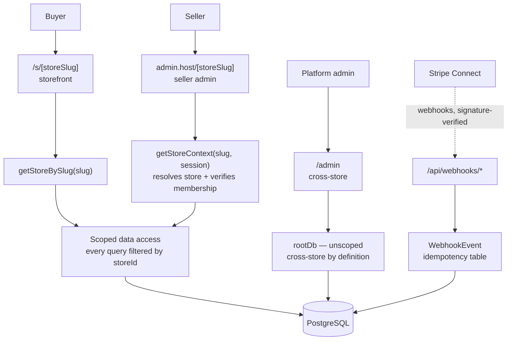

# Tender — a multi-tenant e-commerce platform

Anyone can sign up, open a store, list products and take real payments. Each
store is an isolated tenant with its own catalogue, its own orders and its own
Stripe account; the platform takes a commission at the moment of the charge.

> **Status: in active development.** Schema, tenancy, auth, store creation, slug
> routing, product management and seed data are in. Stripe Connect, checkout, the
> discount engine and the admin surfaces are next — see [Roadmap](#roadmap).

---

## What works today

| | |
|---|---|
| Platform landing | Lists live stores at `/` |
| Storefronts | `/s/nordhavn-supply`, `/s/rosewater-ceramics` — branded per store, 15 products each |
| Auth | Email/password via Supabase Auth, with both email-confirmation callback shapes wired |
| Store creation | `/dashboard/new` — slug validation with live availability checking |
| Seller admin | `admin.<host>/[storeSlug]` — its own subdomain, with a left drawer: Home, Orders, Products, Customers, Discounts, Analytics |
| Product management | `admin.<host>/[storeSlug]/products` — create, edit and delete products with variants and uploaded photos; draft / published / archived |
| Seed | Two stores, 30 products, 56 variants, 6 collections, 6 discounts — idempotent |

---

## Stack

| Layer | Choice | Why |
|---|---|---|
| Framework | Next.js 16 (App Router) + TypeScript | Server Components keep tenant-scoped queries on the server by construction |
| Styling | Tailwind CSS v4 | |
| Database | PostgreSQL (Supabase) | |
| ORM | Prisma 7 | Client Extensions let the scoped data-access layer be enforced in one place rather than remembered at every call site |
| Auth | Supabase Auth | Same vendor as the database, and it keeps Postgres RLS reachable as a defence-in-depth stretch goal |
| Payments | Stripe Connect (Standard) | See below |
| Email | Resend | |
| Hosting | Vercel | |

### Why Connect **Standard**

Account type is the payments decision that is expensive to reverse. It fixes who
owns identity verification, who absorbs a chargeback, and how much onboarding UI
becomes the platform's problem.

| | Standard | Express | Custom |
|---|---|---|---|
| KYC | Stripe | Stripe, in a flow you trigger | The platform |
| Onboarding | Stripe OAuth redirect | Account Links, lightly branded | Built from scratch |
| Seller dashboard | Full Stripe Dashboard | Cut-down Express dashboard | Built from scratch |
| Disputes, negative balances | Seller | Usually the platform | Platform |
| Pre-existing Stripe account | Reusable | No | No |
| Per-account monthly fee | None | Yes | Yes |

**Standard was chosen.** At this scope the differentiator is *where the risk
sits*, not the onboarding UI. Identity verification and payout disputes belong
with Stripe, and a seller who already has a Stripe account keeps it. The price
is an onboarding hop that visibly leaves the app and looks like Stripe, plus
sellers handling disputes in Stripe's dashboard rather than this one — a cheap
trade when [refunds are out of scope](#out-of-scope) anyway.

**Express** would be right if onboarding conversion were the business. Here it
would buy branding in exchange for Account Link plumbing: link expiry, resume-
setup states, polling `charges_enabled` before the seller is allowed to sell.
**Custom** means owning KYC and a regulatory surface this project has no
business taking on.

What that choice commits the code to:

- **Direct charges.** The Checkout Session is created *on* the connected
  account — `{ stripeAccount: store.stripeAccountId }` — with commission taken
  as `application_fee_amount`. Stripe's processing fee comes out of the
  seller's side, not the platform's.
- **The buyer's card statement shows the seller,** not the platform. Correct
  for a marketplace, and worth knowing before the first "what is this charge"
  email.
- **Connect webhooks are their own endpoint.** Connect events carry an
  `account` field identifying the seller and are signed with a different secret
  than the platform's own events.
- **This database is the source of truth for orders.** Charges live on the
  connected account and aren't queryable from the platform account by default.
- **A store cannot sell until Stripe says so.** `stripeChargesEnabled` is set
  from `account.updated`, and publishing and checkout are gated on it — a row
  with a `stripeAccountId` is not the same thing as a store that can take money.

---

## Architecture



The important edge is `getStoreContext`. Seller-admin requests resolve their
tenant from the **URL slug plus the authenticated session**, never from a field
in the request body. Everything downstream receives an already-verified
`store.id`.

### The admin subdomain

The seller admin is served from `admin.<host>`; the platform — landing page,
login, storefronts, the store list — stays on the root host. `src/proxy.ts`
rewrites `admin.tender.com/acme/orders` onto the internal route
`/dashboard/acme/orders`, and redirects each host's traffic to whichever one
owns it, so every page has exactly one canonical URL.

Internally the route tree kept its old shape. That is the point: route files,
`getStoreContext()` and `revalidatePath()` all still speak `/dashboard/…`, so
moving the admin onto a subdomain did not become a rename of every route in the
app. The rules live in `src/lib/admin/routing.ts` as pure functions with tests —
a proxy is exactly where an untested branch becomes a redirect loop.

Three consequences worth knowing:

- **The host proves nothing.** A request arriving on `admin.` is no more trusted
  than one arriving anywhere else. Membership is still proved by
  `getStoreContext()`, which 404s — not 403s — for non-members.
- **`redirect()` and `revalidatePath()` diverge.** They take strings that look
  identical and are not: `revalidatePath` names an internal route and keeps the
  `/dashboard` prefix, while `redirect` names a URL a browser will visit and
  goes through `src/lib/admin/links.ts`.
- **One session spans both hosts.** The Supabase auth cookie is written with
  `Domain=<root hostname>` rather than host-only. Without that, a cookie set at
  login on the root host is never sent to the admin subdomain.

Setting `NEXT_PUBLIC_ADMIN_HOST` to the same host as `NEXT_PUBLIC_APP_URL`
switches the whole split off, and `/dashboard/<slug>` paths work exactly as they
did before — useful anywhere wildcard DNS is not available.

---

## Tenancy model

Four layers, because any one of them alone is a single point of failure.

**1. Schema.** Every root entity carries `storeId`, and every uniqueness
constraint a tenant can influence is composite with it:

```
@@unique([storeId, slug])   // products, collections
@@unique([storeId, code])   // discounts
@@unique([storeId, orderNumber])
@@unique([storeId, sku])    // variants
```

Two stores can both sell `/p/black-tee` and both define `WELCOME10`. The seed
does exactly that, so the constraint is exercised from day one.

`Variant` also carries a denormalised `storeId`. A variant id is the one
catalogue identifier a client hands us raw — add-to-cart, checkout lines — so it
is the prime IDOR surface. Carrying the tenant key locally turns "does this
variant belong to this store?" into one indexed predicate instead of a two-hop
join through `Product`.

**2. A scoped data-access layer.** Route handlers do not call the ORM directly.
`src/lib/db/root.ts` exports the unscoped client with a comment naming its only
three legitimate callers; everything store-scoped goes through
`src/lib/stores/context.ts`.

**3. Isolation tests.** Not yet written. The contract they will pin down: seller
A cannot read B's orders, edit B's products, apply B's discount code, or see B's
revenue.

**4. The Supabase Data API is closed.** Supabase publishes every table in
`public` through PostgREST, and its stock grants give `anon` and `authenticated`
full DML on each one. `anon` is the role behind `NEXT_PUBLIC_SUPABASE_ANON_KEY`,
which ships to every browser that loads the app — so the default posture leaves
orders, carts and users readable and writable by anyone who reads the page
source, on a route that never runs the application code enforcing `storeId`.

The migration `20260827080543_revoke_data_api_access` closes it outright rather
than modelling it with policies: the table, sequence and function grants are
revoked from both roles, so are the default privileges that would re-grant them
on the next `CREATE TABLE`, and RLS is enabled with no policies on all fifteen
tables as a deny-all backstop. Nothing here needs the Data API — `supabase-js`
is called only for `auth.*` and Storage, and every database read and write goes
through Prisma on the direct connection. `service_role` is left intact: it is
server-only, and the seed and product image uploads depend on it.

> RLS here is a backstop, not the tenancy mechanism. Prisma connects as the
> table owner, which bypasses it. Per-tenant RLS policies — scoping enforced in
> the database rather than above it — remain a stretch goal.

**Product images** are the one thing that lives outside Postgres. They go to the
`product-images` Storage bucket under a `<storeId>/` prefix, written server-side
with `service_role` after `getStoreContext()` has already tied the store to the
session — so the tenant prefix is never taken from anything a client sent. No
storage policies are created, which leaves `anon` able to read (storefront photos
are public by definition, and `next/image` cannot optimise what it cannot fetch)
and unable to upload, list or delete. Verified against the live project.

> Supabase's `remove()` reports no error when a policy filters the object out, so
> a delete that did nothing looks like a delete that worked. The object surviving
> is the thing to assert, not the absent error.

---

## Design decisions worth defending

1. **Money is integer cents, everywhere.** `parseMoneyToCents` reads digits out
   of the string rather than going via `parseFloat(x) * 100` — 1.005 is not
   exactly representable in binary floating point and that route silently
   rounds it *down*. Tested.
2. **`OrderLine` snapshots title and price.** An order is a historical record,
   not a join. Deleting a product must not rewrite what someone was charged.
3. **`platformFeeCents` and `sellerNetCents` are stored on the order**, never
   recomputed. Commission rates change; settled orders must not.
4. **Commission is charged on the post-discount total.** The platform takes a
   cut of what the buyer actually paid. A seller running a 20% promotion is not
   billed commission on the 20% they gave away.
5. **`WebhookEvent` exists solely for idempotency.** Stripe retries; a replayed
   event must not decrement inventory twice.
6. **The cart is store-scoped.** One cart per store, no cross-store checkout —
   see [Out of scope](#out-of-scope).
7. **Non-members get 404, not 403,** on `/dashboard/[storeSlug]`. A seller
   poking at a rival's slug should learn nothing, including whether the guess
   was right.
8. **Rendering mode never depends on environment variables.**
   `getCurrentUser()` calls `connection()` before checking whether Supabase is
   configured. Without it, a build with no keys prerenders `/dashboard` as a
   static redirect and then silently switches to dynamic once keys are added.

---

## Out of scope

Named deliberately, not forgotten:

custom domains per store · cross-store unified cart · product reviews ·
subscriptions · refunds · tax calculation · multi-currency · shipping-rate APIs ·
seller analytics beyond basics · i18n

**On cross-store carts specifically:** splitting one payment across multiple
connected accounts is a genuinely hard settlement problem — separate charges,
separate refund paths, partial-failure handling. It is not a UI convenience and
it is not in this project.

**On custom domains:** wildcard DNS plus per-tenant SSL provisioning is
infrastructure work well outside this project's scope. Path-based routing ships.

---

## Local setup

Requires Node 22+.

```bash
npm install
```

**1. Database.** Either a local Postgres or a Supabase project.

```bash
npx prisma dev --name ecom
```

That prints `DATABASE_URL` and `SHADOW_DATABASE_URL`. Copy `.env.example` to
`.env` and paste them in.

**2. Supabase** (needed for auth; storefronts work without it). Create a project
at [supabase.com](https://supabase.com), then from Project Settings → API Keys
copy the project URL, the *publishable* key (`sb_publishable_…`) and a *secret*
key (`sb_secret_…`) into `.env`. Supabase renamed these: publishable was the
anon key, secret was the service-role key. The variable names in `.env.example`
keep the old spelling — only the values changed.

Set the redirect URLs under Authentication → URL Configuration:

```
http://localhost:3000/auth/confirm
http://localhost:3000/auth/callback
```

Then, under Authentication → Emails → Templates, change **Confirm signup** to
send the token hash:

```html
<h2>Confirm your signup</h2>
<p>
  <a href="{{ .RedirectTo }}&token_hash={{ .TokenHash }}&type=signup"
    >Confirm your email</a
  >
</p>
```

This is worth doing even though `/auth/confirm` also accepts the stock
`{{ .ConfirmationURL }}` template. That default sends the user through
Supabase's own verify endpoint, which hands back a PKCE code redeemable only in
the browser that signed up — so confirming from a phone, or from webmail in a
second browser, fails. A token hash carries no such tie and works anywhere.

Appending to `{{ .RedirectTo }}` rather than rebuilding the URL from
`{{ .SiteURL }}` is what preserves the `next` path the app put on
`emailRedirectTo`, so a user confirming from a deep link still lands where they
were headed.

If you point `DATABASE_URL` at Supabase rather than a local database, append
`?sslmode=verify-full&sslrootcert=./certs/supabase-ca.crt`. The pooler serves a
certificate signed by Supabase's own root CA, which the driver behind
`@prisma/adapter-pg` rejects when the system trust store is all it has. That
path is resolved against the process working directory, so every entry point —
dev server, seed, scripts — has to be launched from the repo root.
`.env.example` carries the long version, including why the session pooler is the
one to use.

**3. Product image storage.**

```bash
npm run storage:setup
```

Creates the public `product-images` bucket that seller uploads go to. Idempotent,
and safe to re-run after changing the limits in `scripts/setup-storage.ts`.

**4. Migrate and seed.**

```bash
npm run db:migrate
npm run db:seed
```

With `SUPABASE_SERVICE_ROLE_KEY` set, the seed also provisions the demo accounts
in Supabase Auth so you can log in as them:

| Account | Role |
|---|---|
| `nordhavn@example.com` | owns `/s/nordhavn-supply` |
| `rosewater@example.com` | owns `/s/rosewater-ceramics` |
| `admin@example.com` | platform admin |

Password: `tender-demo-2026`. Demo fixtures — never reuse these anywhere real.

**5. Run.**

```bash
npm run dev
```

Locally that is one host:

| | |
|---|---|
| `http://localhost:3000` | Everything — landing page, login, storefronts, your store list |
| `http://localhost:3000/dashboard/<slug>` | The seller admin |

In production the seller admin moves to its own subdomain, `admin.<your-domain>`,
and `/dashboard/<slug>` redirects there. `.env` ships with
`NEXT_PUBLIC_ADMIN_HOST="localhost:3000"`, which switches that split off for
local development; clearing it turns it back on.

The reason local development does not run the split is the session rather than
the routing. One session has to cover both hosts, which takes an auth cookie
scoped to the parent domain, and `localhost` cannot carry one: it is a public
suffix, so RFC 6265 §5.3 has the browser *downgrade* `Domain=localhost` to a
host-only cookie rather than honour it. `admin.localhost` never receives the
session, and a signed-in seller bounces between the login page and an admin that
cannot see them.

A hostname with a dot does carry it, so the split can be run locally by clearing
`NEXT_PUBLIC_ADMIN_HOST` and pointing `NEXT_PUBLIC_APP_URL` at one:

- **`http://lvh.me:3000`** — `lvh.me` and `*.lvh.me` are public DNS names
  resolving to 127.0.0.1, so nothing needs adding to `/etc/hosts`.
- **A name of your own** — `127.0.0.1  tender.test admin.tender.test` in
  `/etc/hosts`. `.test` is reserved for this (RFC 6761) and, unlike `.local`,
  does not collide with mDNS.

Either way the browser marks plain `http://` on a real hostname Not Secure —
only `localhost` is treated as a trustworthy origin. For a padlock, issue a
certificate covering both hosts with [mkcert](https://github.com/FiloSottile/mkcert)
(`mkcert lvh.me "*.lvh.me"`) and pass it to `next dev --experimental-https-key`
and `--experimental-https-cert`.

### Deploying

Nothing about the split is production-only — the same variables describe it
anywhere:

| | |
|---|---|
| `NEXT_PUBLIC_APP_URL` | `https://your-domain.com` |
| `NEXT_PUBLIC_ADMIN_HOST` | empty, so the admin host is derived as `admin.your-domain.com` |
| DNS | an `admin.` record pointing at the same deployment |
| Supabase → Authentication → URL Configuration | `https://your-domain.com/auth/confirm` and `/auth/callback` |

The auth cookie's `Domain` is derived from the host (`your-domain.com`), so one
session covers the platform and the admin. A real domain has a real parent, so
the public-suffix problem that rules out `localhost` does not arise.

### Scripts

| | |
|---|---|
| `npm run dev` | Dev server |
| `npm run build` | Generate Prisma client, then production build |
| `npm test` | Vitest |
| `npm run typecheck` | `tsc --noEmit` (run `npm run build` first — Next generates route types) |
| `npm run db:migrate` | Create and apply a migration (local `prisma dev` database) |
| `npm run db:deploy` | Apply existing migrations — hosted Postgres, CI, production |
| `npm run db:seed` | Seed the demo stores (idempotent) |
| `npm run seed:images` | Refresh seed photography from Openverse |

---

## Roadmap

| Milestone | Ships | |
|---|---|---|
| Foundation | Scaffold, multi-tenant schema, auth, store creation, slug routing, seed | ✅ |
| Data layer | Product CRUD with images and variants ✅; scoped data-access layer + isolation tests still to come | ◐ |
| Storefront | Listing, search, filters, detail, cart | |
| Connect | Stripe Connect onboarding, `account.updated` webhook, activation gating | |
| Checkout | Direct charges with application fee, `payment_intent.succeeded`, inventory, emails | |
| Discounts | Discount engine + tests, discount admin, checkout integration | |
| Surfaces | Seller dashboard, platform admin, buyer order history, mobile pass | |

---

## Credits

Demo photography is openly licensed and pulled from
[Openverse](https://openverse.org). See [CREDITS.md](CREDITS.md).
