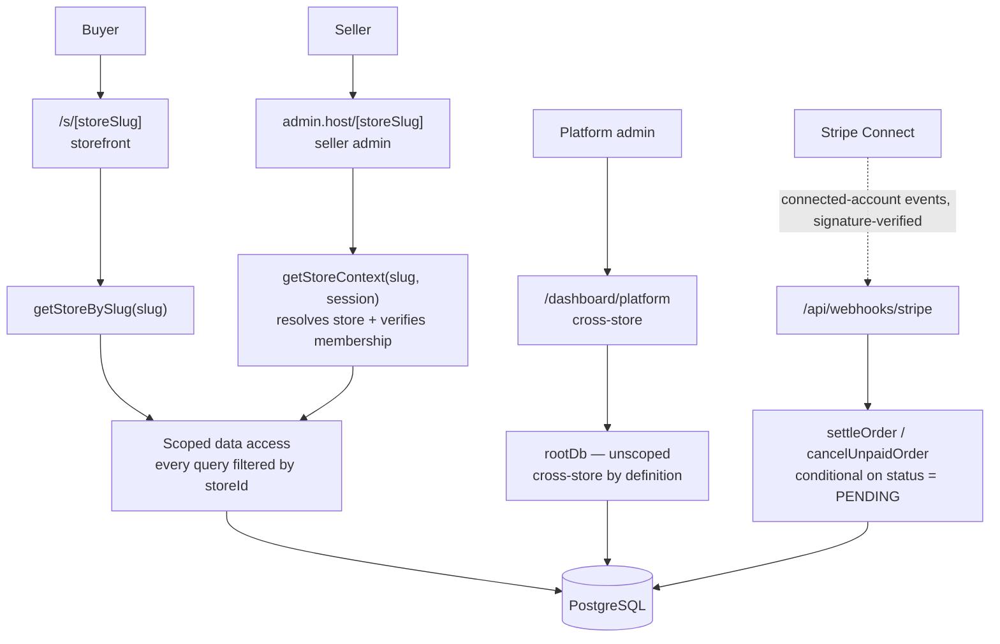

# Architecture

How Tender keeps stores apart, why payments are shaped the way they are, and
the decisions behind both. For what the app does, see
[features.md](features.md); to run it, [setup.md](setup.md).

- [Overview](#overview)
- [The admin subdomain](#the-admin-subdomain)
- [Tenancy model](#tenancy-model)
- [Payments: why Standard-equivalent accounts](#payments-why-standard-equivalent-accounts)
- [Design decisions worth defending](#design-decisions-worth-defending)
- [Out of scope](#out-of-scope)

---

## Overview



The important edge is `getStoreContext`. Seller-admin requests resolve their
tenant from the **URL slug plus the authenticated session**, never from a field
in the request body. Everything downstream receives an already-verified
`store.id`.

---

## The admin subdomain

The seller admin is served from `admin.<host>`; the platform — landing page,
login, storefronts, the store list — stays on the root host. `src/proxy.ts`
rewrites `admin.tender.com/acme/orders` onto the internal route
`/dashboard/acme/orders`, and redirects each host's traffic to whichever one
owns it, so every page has exactly one canonical URL.

Internally the route tree kept its old shape. That is the point: route files,
`getStoreContext()` and `revalidatePath()` all still speak `/dashboard/…`, so
moving the admin onto a subdomain did not become a rename of every route in the
app. The rules live in `src/lib/admin/routing.ts` as pure functions with tests —
a proxy is exactly where an untested branch becomes a redirect loop.

Three consequences worth knowing:

- **The host proves nothing.** A request arriving on `admin.` is no more trusted
  than one arriving anywhere else. Membership is still proved by
  `getStoreContext()`, which 404s — not 403s — for non-members.
- **`redirect()` and `revalidatePath()` diverge.** They take strings that look
  identical and are not: `revalidatePath` names an internal route and keeps the
  `/dashboard` prefix, while `redirect` names a URL a browser will visit and
  goes through `src/lib/admin/links.ts`.
- **One session spans both hosts.** The Supabase auth cookie is written with
  `Domain=<root hostname>` rather than host-only. Without that, a cookie set at
  login on the root host is never sent to the admin subdomain.

Setting `NEXT_PUBLIC_ADMIN_HOST` to the same host as `NEXT_PUBLIC_APP_URL`
switches the whole split off, and `/dashboard/<slug>` paths work exactly as they
did before — useful anywhere wildcard DNS is not available, which is how local
development and the `*.vercel.app` demo run. Why `localhost` cannot carry the
split is in [setup.md](setup.md#running-the-admin-subdomain-locally).

---

## Tenancy model

Four layers, because any one of them alone is a single point of failure.

**1. Schema.** Every root entity carries `storeId`, and every uniqueness
constraint a tenant can influence is composite with it:

```
@@unique([storeId, slug])   // products, collections
@@unique([storeId, code])   // discounts
@@unique([storeId, orderNumber])
@@unique([storeId, sku])    // variants
```

Two stores can both sell `/p/black-tee` and both define `WELCOME10`. The seed
does exactly that, so the constraint is exercised from day one.

`Variant` also carries a denormalised `storeId`. A variant id is the one
catalogue identifier a client hands us raw — add-to-cart, checkout lines — so it
is the prime IDOR surface. Carrying the tenant key locally turns "does this
variant belong to this store?" into one indexed predicate instead of a two-hop
join through `Product`.

**2. A scoped data-access layer.** Route handlers do not call the ORM directly.
`src/lib/db/root.ts` exports the unscoped client with a comment naming its only
legitimate callers; everything store-scoped goes through
`src/lib/stores/context.ts`, and every query module takes the resolved
`storeId` as its first argument.

**3. Isolation tests.** Not yet written. The contract they will pin down: seller
A cannot read B's orders, edit B's products, apply B's discount code, or see B's
revenue.

**4. The Supabase Data API is closed.** Supabase publishes every table in
`public` through PostgREST, and its stock grants give `anon` and `authenticated`
full DML on each one. `anon` is the role behind `NEXT_PUBLIC_SUPABASE_ANON_KEY`,
which ships to every browser that loads the app — so the default posture leaves
orders, carts and users readable and writable by anyone who reads the page
source, on a route that never runs the application code enforcing `storeId`.

The migration `20260827080543_revoke_data_api_access` closes it outright rather
than modelling it with policies: the table, sequence and function grants are
revoked from both roles, so are the default privileges that would re-grant them
on the next `CREATE TABLE`, and RLS is enabled with no policies as a deny-all
backstop. Nothing here needs the Data API — `supabase-js` is called only for
`auth.*`, Storage and Realtime, and every database read and write goes through
Prisma on the direct connection. `service_role` is left intact: it is
server-only, and the seed and product image uploads depend on it.

> RLS here is a backstop, not the tenancy mechanism. Prisma connects as the
> table owner, which bypasses it. Per-tenant RLS policies — scoping enforced in
> the database rather than above it — remain a stretch goal.

**Product images** are the one thing that lives outside Postgres. They go to the
`product-images` Storage bucket under a `<storeId>/` prefix, written server-side
with `service_role` after `getStoreContext()` has already tied the store to the
session — so the tenant prefix is never taken from anything a client sent. No
storage policies are created, which leaves `anon` able to read (storefront photos
are public by definition, and `next/image` cannot optimise what it cannot fetch)
and unable to upload, list or delete.

> Supabase's `remove()` reports no error when a policy filters the object out, so
> a delete that did nothing looks like a delete that worked. The object surviving
> is the thing to assert, not the absent error.

**Live order alerts** use Supabase Realtime on private channels only
(`store:<id>:orders`). The `private.broadcast_order_paid()` trigger announces a
paid order; joining the channel is authorised against store membership, so a
seller never hears another store's orders.

---

## Payments: why Standard-equivalent accounts

Account type is the payments decision that is expensive to reverse. It fixes who
owns identity verification, who absorbs a chargeback, and how much onboarding UI
becomes the platform's problem.

| | Standard | Express | Custom |
|---|---|---|---|
| KYC | Stripe | Stripe, in a flow you trigger | The platform |
| Onboarding | Stripe-hosted (Account Links) | Stripe-hosted, lightly branded | Built from scratch |
| Seller dashboard | Full Stripe Dashboard | Cut-down Express dashboard | Built from scratch |
| Disputes | Seller | Seller, via the platform | Platform |
| Negative balances | Stripe | Platform | Platform |
| Per-account monthly fee | None | Yes | Yes |

**Standard was chosen.** At this scope the differentiator is *where the risk
sits*, not the onboarding UI. Identity verification, payouts and disputes
belong with Stripe and the seller, and the seller gets the full Stripe
Dashboard to handle them — a cheap trade when refunds are made there and
synced back rather than built in-app (see [Out of scope](#out-of-scope)).

Accounts are created with Stripe's **Accounts v2 API** (`/v2/core/accounts`):
`dashboard: "full"`, `defaults.responsibilities` of
`fees_collector: "stripe"` and `losses_collector: "stripe"` — which makes
Stripe responsible for KYC — and the `merchant` configuration with card
payments requested. Stripe reports that combination as a Standard account.
Owners onboard through v2 **Account Links**, Stripe-hosted onboarding.

Why not the older routes: Stripe refuses Accounts v1 creation for new Connect
platforms unless a compatibility setting is switched on, and its docs say OAuth
"isn't recommended for new Connect platforms". The costs of v2:

- **The owner picks their country before going to Stripe.** Accounts v2 needs
  it to add the merchant configuration, and it can't change afterwards.
  Settings → Payments offers the countries where Stripe takes merchants
  (`STRIPE_MERCHANT_COUNTRIES` in `src/lib/payments/rules.ts`, from
  stripe.com/global — Stripe's Country Specs API also lists countries it only
  pays out to).
- **A seller who already has a Stripe account** signs in with it but gets a new
  account for Tender, rather than connecting the old one.
- **Readiness is read from capabilities, not flags.** "Can take money" is
  `configuration.merchant.capabilities.card_payments.status === "active"`;
  "has submitted their details" is "card payments requested and no requirement
  awaiting the seller" (`accountReadiness`). Accounts created earlier through
  v1 read the same way — Accounts v2 manages them too.

**Express** would be right if onboarding conversion were the business, and
**Custom** means owning KYC and a regulatory surface this project has no
business taking on.

What that choice commits the code to:

- **Direct charges.** Each order's PaymentIntent is created *on* the connected
  account — `{ stripeContext: store.stripeAccountId }` — with commission taken
  as `application_fee_amount`. Stripe's processing fee comes out of the
  seller's side, not the platform's. Stripe.js loads as the same account, so the
  Payment Element can confirm it.
- **The buyer's card statement shows the seller,** not the platform. Correct
  for a marketplace, and worth knowing before the first "what is this charge"
  email.
- **One webhook endpoint, for connected accounts.** With direct charges, every
  event Tender acts on — account and capability updates, deauthorisation,
  PaymentIntent outcomes, refunds and disputes — happens on a seller's account.
  (Accounts v2 accounts still send these v1 events, in the connected-accounts
  scope; `capability.updated` is the one that says card payments switched on.)
  They arrive at `/api/webhooks/stripe` with an `account` field naming the
  seller. Connect also delivers the seller's own payments taken elsewhere;
  PaymentIntents without Tender's order id in their metadata are ignored.
- **This database is the source of truth for orders.** Charges live on the
  connected account and aren't queryable from the platform account by default.
- **A store cannot sell until Stripe says so.** `stripeChargesEnabled` is
  copied from the account — on `account.updated` and `capability.updated`,
  and whenever the owner opens Settings → Payments — and card checkout is gated
  on it. The handler re-reads the account rather than trusting the payload, and
  the v2 read can trail the v1 event by a few seconds: when a recent event says
  card payments just went live but the read disagrees, the handler re-reads
  for a few seconds, then answers 500 so Stripe redelivers instead of leaving
  the store closed (`eventSignalsCardActive`). A row with a
  `stripeAccountId` is not the same thing as a store that can take money.
  Finishing onboarding is also what moves a new store from PENDING to ACTIVE.
- **Stock is taken when the money is in, not when the order is placed.** An
  order is placed unpaid with its discounts redeemed, then paid by its
  PaymentIntent; the transaction that flips it to PAID takes the stock and
  empties the cart. An abandoned payment holds no stock, and placing the order
  again cancels the old attempt — PaymentIntent first — and gives its discount
  uses back. (Cash on delivery is the exception: a COD order takes its stock
  when placed, because there is a parcel to send.)

---

## Design decisions worth defending

1. **Money is integer cents, everywhere.** `parseMoneyToCents` reads digits out
   of the string rather than going via `parseFloat(x) * 100` — 1.005 is not
   exactly representable in binary floating point and that route silently
   rounds it *down*. Tested.
2. **`OrderLine` snapshots title and price.** An order is a historical record,
   not a join. Deleting a product must not rewrite what someone was charged.
3. **`platformFeeCents` and `sellerNetCents` are stored on the order**, never
   recomputed. Commission rates change; settled orders must not.
4. **Commission is charged on the post-discount total.** The platform takes a
   cut of what the buyer actually paid. A seller running a 20% promotion is not
   billed commission on the 20% they gave away.
5. **Stock moves only in the transaction that flips an order to PAID.** Stripe
   retries webhooks, and the confirmation page settles the order too, so the
   same payment can arrive twice at once. Settling is a conditional
   `UPDATE … WHERE status = 'PENDING'`, and only the call whose update actually
   changed the row takes stock, empties the cart or — for a cancellation — gives
   discount uses back. A replay finds the order already moved and does nothing.
   `WebhookEvent` records which events were handled and short-circuits
   redeliveries; it is not what makes them safe.
6. **The cart is store-scoped.** One cart per store, no cross-store checkout —
   see [Out of scope](#out-of-scope).
7. **Non-members get 404, not 403,** on `/dashboard/[storeSlug]`. A seller
   poking at a rival's slug should learn nothing, including whether the guess
   was right.
8. **Rendering mode never depends on environment variables.**
   `getCurrentUser()` calls `connection()` before checking whether Supabase is
   configured. Without it, a build with no keys prerenders `/dashboard` as a
   static redirect and then silently switches to dynamic once keys are added.
9. **Discount rules are enforced twice, usage limits once — at the right
   moment.** The form parser (`src/lib/discounts/form.ts`) explains a bad
   discount in words; CHECK constraints in `20260926160000_discount_rules`
   refuse one from any other write path. The engine
   (`src/lib/discounts/engine.ts`) decides amounts from counts it read earlier,
   which is fine for showing a total; `redeemDiscounts` re-checks inside the
   order transaction with a conditional `UPDATE … WHERE usage_count <
   usage_limit`, so two buyers racing for the last use cannot both get it.
   Customer segments are rules over order history, not stored lists — there is
   no customers table to keep in step.
10. **Shipping is quoted in one pure function, and the client only ever
    requests.** `quoteCheckout` (`src/lib/checkout/quote.ts`) prices item
    discounts first, picks the zone and the rates the order qualifies for, then
    prices again with the chosen rate so a free-shipping discount takes
    exactly that off. A rate id from the browser is a request: one that is not
    among the eligible rates for this store, address and cart is never
    charged, and the order transaction re-reads the rate by id, store, zone and
    price. Addresses, the rate's name, zone and estimate, and the currency are
    snapshotted onto the order like its lines. Tax will be one more term in
    `summarisePricing` and one more column.
11. **"Buy it now" is a second cart, not a detour around the first.** A
    `BUY_NOW` cart beside the buyer's own, keyed the same way, so checkout,
    discount codes, re-pricing and the saved draft all work on it unchanged
    and paying for the order deletes only it. The cost is one more row per
    session; stashing and restoring the everyday cart instead would risk
    losing it on any failure in between.

---

## Out of scope

Named deliberately, not forgotten:

custom domains per store · cross-store unified cart · product reviews ·
subscriptions · in-app refunds (they are made in the seller's Stripe Dashboard
and synced back) · tax calculation · currency conversion (each store sells in
one currency) · shipping-rate APIs · seller analytics beyond basics

**On cross-store carts specifically:** splitting one payment across multiple
connected accounts is a genuinely hard settlement problem — separate charges,
separate refund paths, partial-failure handling. It is not a UI convenience and
it is not in this project.

**On custom domains:** wildcard DNS plus per-tenant SSL provisioning is
infrastructure work well outside this project's scope. Path-based routing ships.
